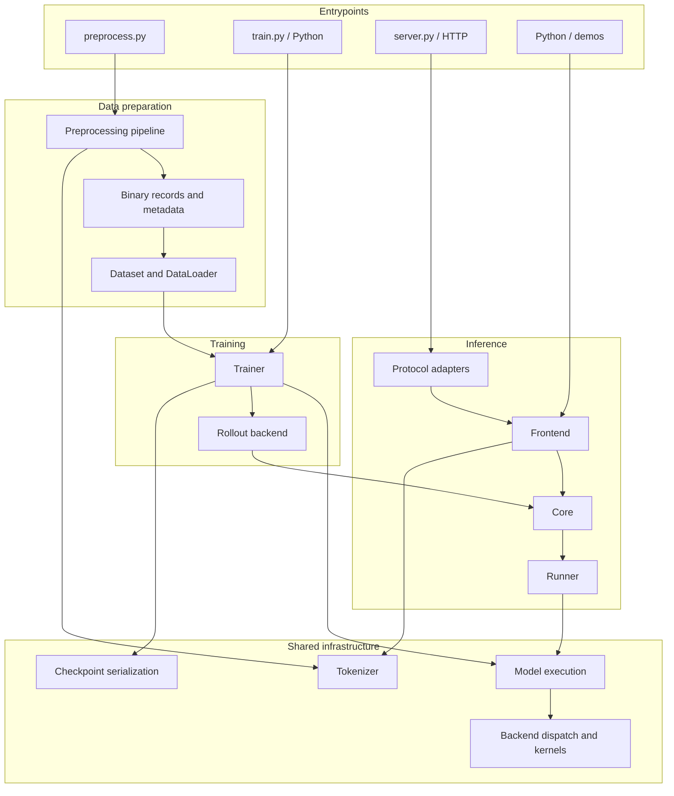
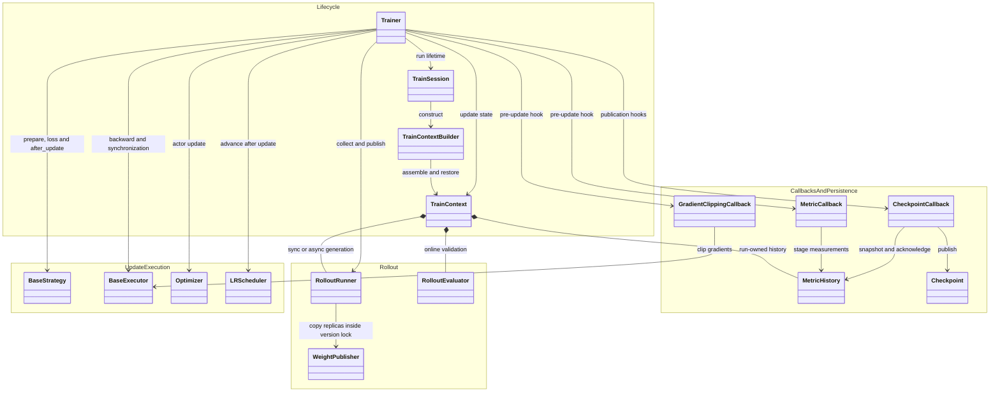
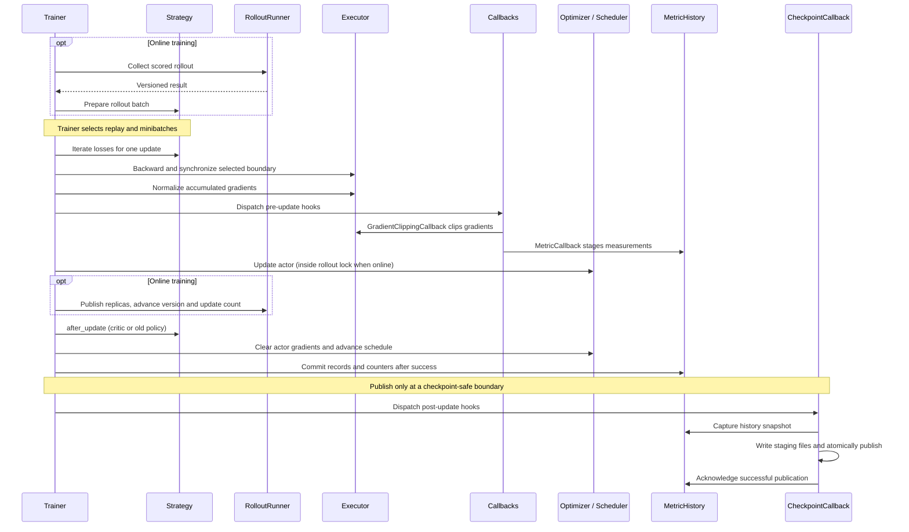
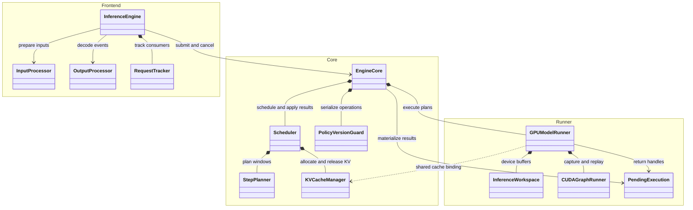

# Architecture

This page describes module boundaries, ownership and execution flow.
Boxes group classes by responsibility; arrows show calls, ownership or data
contracts. Detailed fields and signatures remain in source.

## System overview

CLI tools resolve configuration and call the same Python components used by
applications. Training owns updates; inference owns request execution. They share
model, tokenizer, serialization and kernel infrastructure.

The arrows show calls or data flow, not separate processes. A local training
launcher creates one process per configured distributed rank. Within an
inference instance, Frontend, Core and Runner are in-process layers. Async rollout
creates separate replica processes, each with its own inference instance.

Entrypoints translate user settings into calls. Data preparation produces the
records consumed by training; training owns updates and inference owns request
execution. Shared infrastructure provides computation, tokenization and
serialization without owning either execution loop. The protocol adapter is an
entrypoint around the three-layer inference engine.

## Training

### Construction and lifetime

The CLI merges defaults, YAML and explicit flags into validated configuration.
`ComponentSpec(type, params)` selects training components; construction occurs
inside each rank, after device and topology setup. `TrainContextBuilder` loads
the selected state and assembles runtime objects. `TrainSession` takes ownership
only once a context exists.

This separates serializable settings from live resources such as loaders,
process groups and rollout workers. A builder failure cleans up partially created
rollout resources; a session failure follows the normal shutdown plan.
See [construction lifecycle](trainer/lifecycle.md) for the exact order.

### Module relationships

The four groups describe collaborators, not four sequential training stages.
Lifecycle owns the run, UpdateExecution performs requested algorithm and gradient
operations, Rollout supplies generated data, and CallbacksAndPersistence
contains callback hooks and committed history. `Trainer` coordinates them;
the other groups do not create independent update loops.

- `Trainer` owns global data windows, optimizer updates and committed counters.
- `TrainContextBuilder` resolves components inside each rank; `TrainSession`
  owns startup and ordered cleanup.
- Strategies compute objectives. Executors perform requested parallel operations;
  they do not hide an independent optimizer-step counter.
- Metric and checkpoint callbacks share context-owned history, with no references
  to each other. A checkpoint publishes only at a safe committed boundary.
- Optimizers and schedulers are ordinary PyTorch-compatible objects.
  Precision wrappers and state placement are described in
  [configuration](trainer/configuration.md), not encoded in callback order.

See [lifecycle](trainer/lifecycle.md), [strategies](trainer/strategy.md),
[callbacks](trainer/callbacks.md) and [rollout](trainer/rollout.md).

### Update and publication flow

The sequence shows one successful update reaching a publication boundary.
Online replay can contain several updates before a data window becomes safe.
If an update mutates weights and then fails, counters alone cannot repair the
model; publication remains disabled and the previous checkpoint remains valid.

`MetricHistory` belongs to the run because both measurement and persistence need
the same committed prefix. The callbacks communicate through that state, so
neither callback controls the other. Full-resume state and exported inference
weights serve different purposes; see the [checkpoint contract](../guides/training.md#checkpoint).

## Inference

The inference engine has three layers: **Frontend → Core → Runner**.
Scheduling and KV management belong to Core; workspace and graph execution
belong to Runner. Runner is implemented in the `worker/` package.

Network adapters are entrypoints around Frontend. Model/cache tensor layouts
are dependencies used by Runner, and `contracts.py` carries shared data.
These are not additional inference-engine layers.

| Layer | Owns | Why it is separate |
| --- | --- | --- |
| Frontend | Input processing, consumer tracking, output decoding and text stops | Text APIs can change without altering scheduling; tokenized rollout can enter core directly |
| Core | Execution loop, request queues, planning, KV allocation and policy versions | Scheduling, accepted output and resource lifetime need coordinated state ownership |
| Runner | Input tensors, model execution, sampling, workspace, graphs and deferred results | Device optimizations do not decide request completion or logical KV release |

Source imports point **frontend → core → worker → model/cache layout**.
The worker does not retain mutable scheduler requests, but it still calls
`KVCacheManager.bind()` to turn core allocation state into device cache views.
This shared object is a remaining coupling, not eliminated by type-only imports.
The model itself consumes tensors and cache layouts without request queues.

The engine is an in-process driver. Colocated rollout shares the learner's model
and serializes generation with policy updates. Async rollout uses separate frozen
replicas; that placement is owned by the rollout backend, not the frontend.

The request path is **register → admit → plan → execute → materialize → apply
→ deliver**. Materializing a `PendingExecution` only resolves its result; the
scheduler validates identity and policy version before accepting it. A terminal
event ends consumption, but in-flight GPU work must retire before KV reuse.

The [inference architecture](inference/README.md) expands the layer diagram,
design patterns and execution sequence. [Events](inference/events.md) defines
cancellation and shutdown; [core](inference/core.md) explains allocation and
the remaining cache-binding dependency.

Global token-budget scheduling, progressive prompt-page admission and recompute
preemption remain outside the current inference implementation.

## Shared infrastructure and contracts

Model execution, tokenization, serialization and backend dispatch are shared by
the data, training and inference paths. They provide reusable operations while
their callers retain ownership of request and training progress.

### State ownership

| State | Owner | Lifetime / boundary |
| --- | --- | --- |
| Settings and component specifications | Configuration | Validated before rank-local construction |
| Model, optimizer, loaders and counters | TrainContext | One training run; counters follow committed updates |
| Pending and committed metric records | MetricHistory | Pending until update commit; retained until successful save |
| Requests and KV allocation | Scheduler | Admission through terminal state and in-flight retirement |
| Execution buffers and CUDA graphs | GPUModelRunner | Reused within an inference instance |
| Weight version and mutation lock | PolicyVersionGuard | Serializes shared-model generation, scoring and updates |
| Published checkpoint files | Checkpoint | Immutable step directory after atomic publication |

Changing a boundary should update its focused contract rather than adding an
independent state owner.

### Extension points

Use `Factory.create(name, ...)` for registered components and
`create_from_config()` when selecting constructor fields from a broad config.
Top-level training components use `ComponentSpec(type, params)`; callbacks are
passed as instances. Custom constructors accepting `**kwargs` own their validation.

Operation selection belongs to `astrai.extension`. Exact CUDA wrappers live in
`extension/kernel`; they do not choose fallback implementations. A strict
`op_backend(...)` scope raises for unsupported calls, while automatic dispatch
may choose another compatible backend.

Keep CLI parsing and examples in `scripts/`. Shared execution and validation
belong in `astrai/`. See [testing](testing.md) for the checks that guard these
boundaries.
