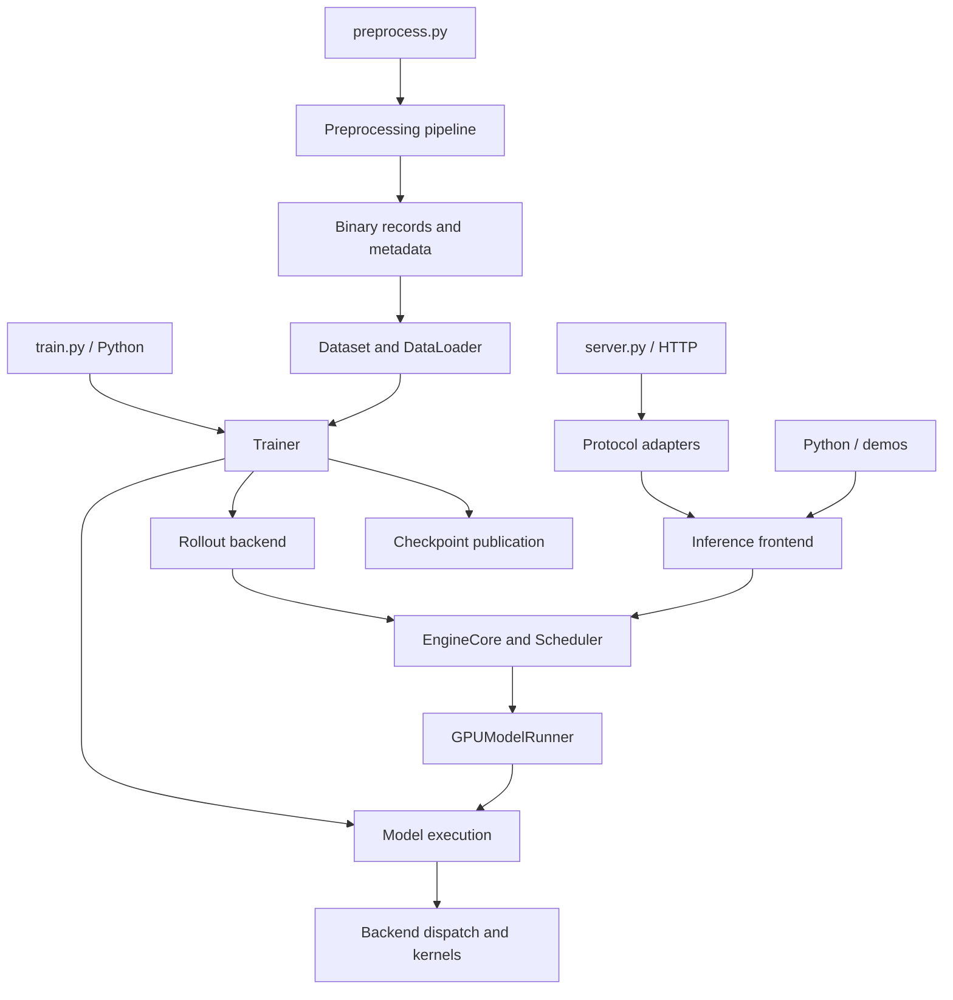
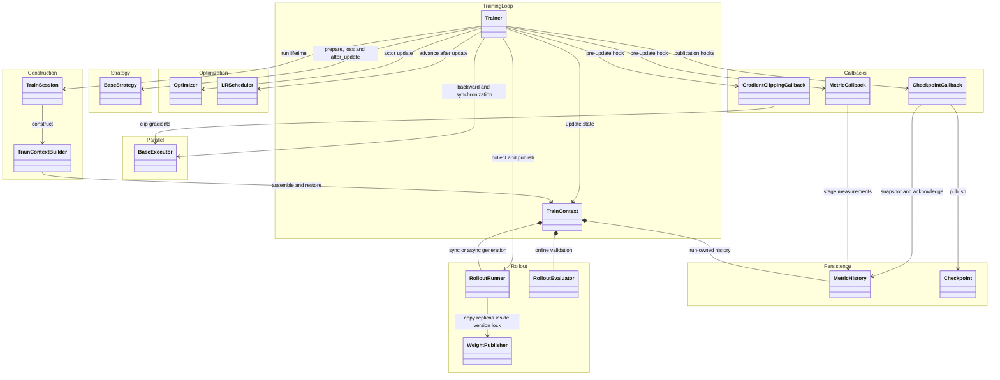
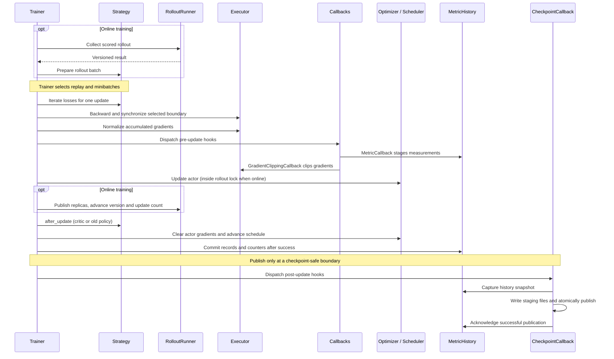
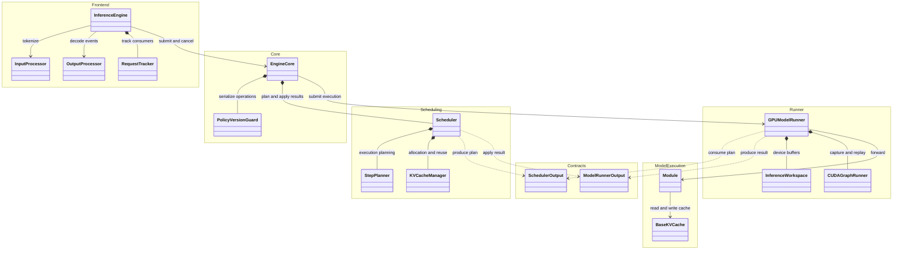
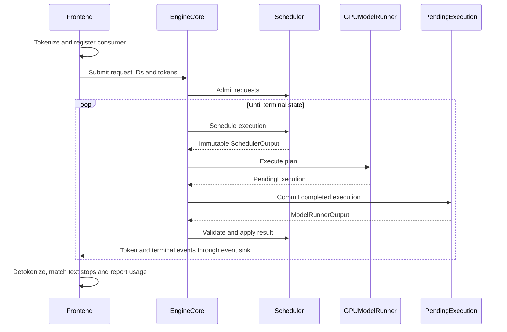

# Architecture

This page describes module boundaries, ownership and execution flow.
Boxes group classes by responsibility; arrows show calls, ownership or data
contracts. Detailed fields and signatures remain in source.

## Entrypoints and layers

CLI tools resolve configuration and call the same Python components used by
applications. Training owns updates; inference owns request execution. They share
model, tokenizer, serialization and kernel infrastructure.

The arrows show calls or data flow, not separate processes. A local training
launcher creates one process per configured distributed rank. Within an
inference instance, frontend, core and worker are in-process layers. Async rollout
creates separate replica processes, each with its own inference instance.

## Configuration and construction

The CLI merges defaults, YAML and explicit flags into validated configuration.
`ComponentSpec(type, params)` selects training components; construction occurs
inside each rank, after device and topology setup. `TrainContextBuilder` loads
the selected state and assembles runtime objects. `TrainSession` takes ownership
only once a context exists.

This separates serializable settings from live resources such as loaders,
process groups and rollout workers. A builder failure cleans up partially created
rollout resources; a session failure follows the normal shutdown plan.
See [construction lifecycle](trainer/lifecycle.md) for the exact order.

## Training ownership

- `Trainer` owns global data windows, optimizer updates and committed counters.
- `TrainContextBuilder` resolves components inside each rank; `TrainSession`
  owns startup and ordered cleanup.
- Strategies compute objectives. Executors perform requested parallel operations;
  they do not hide an independent optimizer-step counter.
- Metric and checkpoint callbacks share context-owned history, with no references
  to each other. A checkpoint publishes only at a safe committed boundary.
- Optimizers and schedulers are ordinary PyTorch-compatible objects.
  Precision wrappers and state placement are described in
  [configuration](trainer/configuration.md), not encoded in callback order.

See [lifecycle](trainer/lifecycle.md), [strategies](trainer/strategy.md),
[callbacks](trainer/callbacks.md) and [rollout](trainer/rollout.md).

### Update and publication flow

The sequence shows one successful update reaching a publication boundary.
Online replay can contain several updates before a data window becomes safe.
If an update mutates weights and then fails, counters alone cannot repair the
model; publication remains disabled and the previous checkpoint remains valid.

`MetricHistory` belongs to the run because both measurement and persistence need
the same committed prefix. The callbacks communicate through that state, so
neither callback controls the other. Full-resume state and exported inference
weights serve different purposes; see the [checkpoint contract](../guides/training.md#checkpoint).

## Inference ownership

**Frontend** owns inputs and output consumers. **Core** drives execution and
serializes policy operations. **Scheduling** owns requests, plans and KV
allocation; it lives in the core package but has no model runner dependency.
**Runner** owns GPU execution, workspace and graph replay.
**Contracts** carries immutable plans and results between scheduling and execution.
The model execution layer consumes tensors and cache views without knowing
about request queues.

Runtime dependencies point **frontend → core → worker → model/cache layout**.
The worker consumes immutable execution contracts and does not retain mutable
scheduler requests. The model-side cache types describe tensors; the inference
core owns allocation and prefix reuse.

The engine is an in-process driver. Colocated rollout shares the learner's model
and serializes generation with policy updates. Async rollout uses separate frozen
replicas; that placement is owned by the rollout backend, not the frontend.

For cancellation, terminal events and resource lifetime, see
[inference events](inference/events.md). For allocation and scheduling limits,
see [inference core](inference/core.md).

### Request execution flow

The diagram shows one logical iteration. Decode overlap can leave multiple
executions in flight. Their identity and policy version travel with the results,
so request mutation or cancellation cannot silently attach output to another
request. Cancellation does not free resources still used by an execution;
retirement and result application own that boundary.

The frontend owns text processing and consumers. The scheduler owns mutable
requests and logical KV accounting. The runner owns device workspace, CUDA graph
capture and model execution. Immutable plans separate those responsibilities
without giving the worker access to live scheduler state.

## State and lifetime

| State | Owner | Lifetime / boundary |
| --- | --- | --- |
| Settings and component specifications | Configuration | Validated before rank-local construction |
| Model, optimizer, loaders and counters | TrainContext | One training run; counters follow committed updates |
| Pending and committed metric records | MetricHistory | Pending until update commit; retained until successful save |
| Requests and KV allocation | Scheduler | Admission through terminal state and in-flight retirement |
| Execution buffers and CUDA graphs | GPUModelRunner | Reused within an inference instance |
| Weight version and mutation lock | PolicyVersionGuard | Serializes shared-model generation, scoring and updates |
| Published checkpoint files | Checkpoint | Immutable step directory after atomic publication |

Colocated rollout shares the learner model, so generation and weight mutation
must use the same version boundary. Replica rollout owns a separate model and
publishes weights through its backend. Async replicas use control messages and
NCCL weight transfer; the [rollout guide](trainer/rollout.md) describes placement
without changing frontend ownership.

## Design choices

| Choice | Reason |
| --- | --- |
| One trainer-owned update boundary | Counters, gradients and persistence agree on which update committed |
| Separate construction and session lifetime | Partial initialization and normal shutdown need different cleanup owners |
| Context-owned metric history | Measurements and checkpoint publication share state without callback coupling |
| Immutable execution contracts | Overlapped work remains attributable after requests change or are cancelled |
| Model-owned cache tensor layouts | Model and kernel code do not depend on inference scheduling policies |
| Backend-owned rollout placement | Objective code consumes scored results independently of where generation runs |

These are the current boundaries. Global token-budget scheduling, progressive
prompt-page admission and recompute preemption remain outside the current
inference implementation; see [inference internals](inference/README.md).
Changing a boundary should update its focused contract rather than adding an
independent state owner.

## Extension boundaries

Use `Factory.create(name, ...)` for registered components and
`create_from_config()` when selecting constructor fields from a broad config.
Top-level training components use `ComponentSpec(type, params)`; callbacks are
passed as instances. Custom constructors accepting `**kwargs` own their validation.

Operation selection belongs to `astrai.extension`. Exact CUDA wrappers live in
`extension/kernel`; they do not choose fallback implementations. A strict
`op_backend(...)` scope raises for unsupported calls, while automatic dispatch
may choose another compatible backend.

Keep CLI parsing and examples in `scripts/`. Shared execution and validation
belong in `astrai/`. See [testing](testing.md) for the checks that guard these
boundaries.
