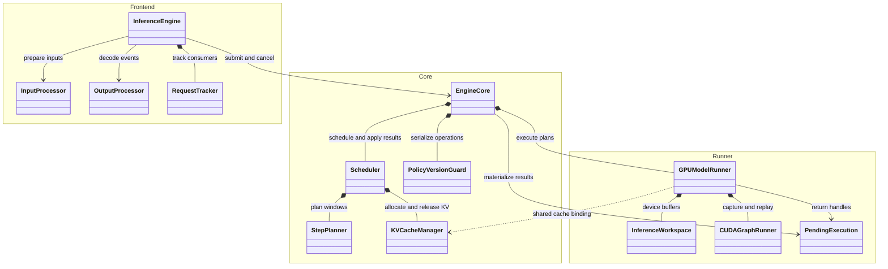
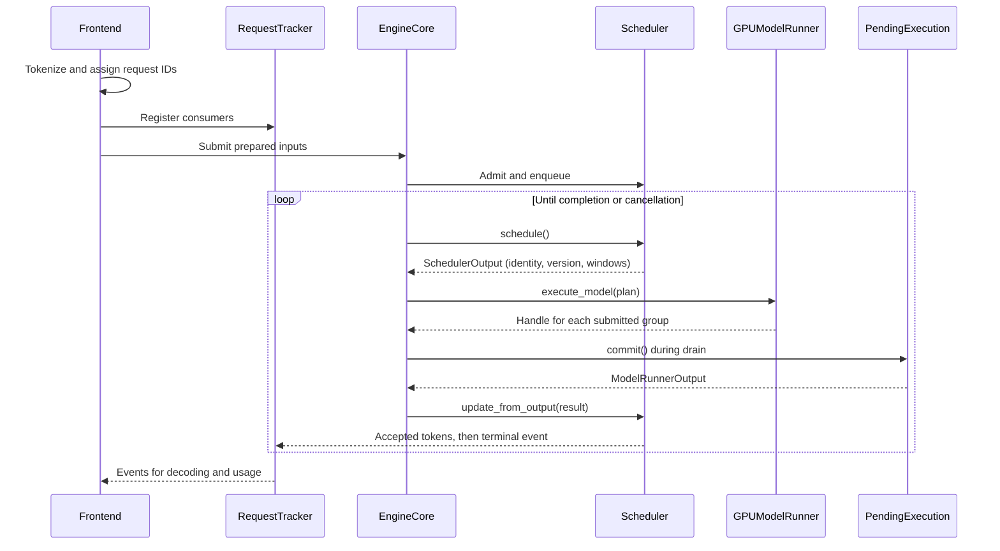

# Inference Architecture

Inference separates user-facing text processing, request scheduling and device
execution. The layers run **in one process**: colocated rollout shares the
trainer's model, while a serving instance uses a background engine thread.
Separate rollout replicas are placed by the training backend.

## Three-layer class relationships

The inference engine has three layers: **Frontend → Core → Runner**.
Scheduling and KV management belong to Core; workspace and graph execution
belong to Runner. Runner is implemented in the `worker/` package.

Network adapters are entrypoints around Frontend. Model/cache tensor layouts
are dependencies used by Runner, and `contracts.py` carries shared data.
These are not additional inference-engine layers.

Composition arrows mark owned collaborators; other arrows mark calls or
dependencies. The dotted Runner-to-Core edge records the existing shared KV
binding dependency. It does not introduce another layer.

| Layer | Owns | Why it is separate |
| --- | --- | --- |
| Frontend | Input processing, consumer tracking, output decoding and text stops | Text APIs can change without altering scheduling; tokenized rollout can enter core directly |
| Core | Execution loop, request queues, planning, KV allocation and policy versions | Scheduling, accepted output and resource lifetime need coordinated state ownership |
| Runner | Input tensors, model execution, sampling, workspace, graphs and deferred results | Device optimizations do not decide request completion or logical KV release |

The source import direction is **frontend → core → worker → model/cache ABI**;
all layers can use `contracts.py`. `tests/inference/test_layering.py` rejects
reverse runtime imports. This is an import rule, not complete object isolation:
the runner receives a shared `KVCacheManager` and calls `bind()` to create model
cache views. That method still combines request lookup with device metadata
assembly. See [the cache boundary](core.md#cache-binding-boundary).

## Design patterns in use

These names describe existing responsibilities; they do not require additional
base classes, registries or forwarding layers.

| Pattern | Current implementation | Benefit and constraint |
| --- | --- | --- |
| Facade | `InferenceEngine.generate`, `generate_events` and `score` | One text API hides registration and cleanup; scheduling stays in core |
| Adapter | OpenAI/Anthropic network modules | Translate protocols around the same frontend; no per-protocol scheduler |
| Strategy | `AllocationStrategy`: contiguous or paged | Real alternative allocation policies share one interface; they need not share prefix-cache behavior |
| Event sink | `OutputEventSink` implemented by `RequestTracker` | Core emits token/terminal events without importing consumers; this is one sink, not a general event bus |
| Immutable execution messages | `SchedulerOutput` and `ModelRunnerOutput` | Identity and version travel with delayed work; the worker cannot mutate a live `Request` through a plan |
| Deferred result | `PendingExecution` | Submission and host materialization are separate; `commit()` resolves data, while the scheduler applies request state |
| Resource reuse | `InferenceWorkspace`, `ResultRing`, `CUDAGraphRunner` | Stable buffers reduce allocation and copying; their reuse must wait for the relevant execution to retire |

`EngineCore` coordinates these collaborators directly. There is no need for a
second executor facade while execution remains local. `StepPlanner` is a small
planning collaborator, not a scheduler plugin hierarchy. Sampling is a function,
and is not represented as a class in the diagrams.

## Cooperation across one execution

This shows logical order. Supported decode overlap may submit the next forward
before materializing the previous result. The distinction between **planned**,
**materialized** and **accepted** progress is therefore necessary:

- A planned window reserves resources but does not prove its KV has been written.
- Materialization waits for execution/copy completion. Even a prefill chunk
  without a sampled token needs this boundary.
- The scheduler validates identity, order and policy version before accepting
  output. Cancellation can discard a result without making its resources safe
  to reuse early.

## State ownership and lifetime

| State | Owner | Release or reuse boundary |
| --- | --- | --- |
| Consumer queues and completion notifications | RequestTracker | Unregister after collection or early exit |
| Live requests and accepted tokens | Scheduler | Terminal state plus retirement of in-flight executions |
| Request-to-KV allocation and prefix index | KVCacheManager / BlockPool | Free after retirement; publish only completed prefix pages |
| Outstanding execution queue | EngineCore | Drain or safely retire every submitted handle |
| Latest decode relay and sampling state | GPUModelRunner | Reuse only for the same ordered request identities and valid KV binding |
| Host copy slots and device buffers | ResultRing / InferenceWorkspace | Completion and consumption before overwrite |
| Model version and mutation lock | PolicyVersionGuard | Stopped/drained engine, successful mutation and KV invalidation |

The core's pending queue accounts for all submitted groups. The runner's latest
decode handle supports relay and overlap checks; it is not a second request
queue. Likewise, consumer completion and GPU resource retirement are different
milestones. Merging these states solely because their names look similar would
erase required lifetime boundaries.

## Current scope and tradeoffs

The useful vLLM-style separation is scheduling versus execution, with explicit
plan/result messages. AstrAI keeps direct in-process calls for shared-model
training; it has no EngineCore/worker RPC or process executor.

Chunked prefill uses a budget **per start-offset group**, reset for each group.
Decode is planned separately, and the runner submits separate forwards by phase
and prefill start offset. This is not a global token budget or a single mixed
prefill/decode forward. Chunking remains off by default.

Both allocation policies preallocate GPU storage. `kv_tokens=None` selects
contiguous allocation; a finite value selects paged allocation, with radix
prefix reuse when `page_size > 1`. Paged admission currently reserves the
prompt's pages. Progressive admission and recompute preemption are not present.

The main remaining ownership issue is shared KV binding. A future change can
make request-slot/length data explicit at that boundary and keep device metadata
assembly with the worker, while preserving fixed addresses and overlap ordering.
Adding an abstract manager alone would leave the same dependency in place.

## Layer details

| Document | Scope |
| --- | --- |
| [Frontend](frontend.md) | Facade, input/output processing and consumer tracking |
| [Core](core.md) | Driver, scheduling, KV ownership and policy versioning |
| [Runner](worker.md) | Execution messages, deferred results and device resources |
| [Events](events.md) | Cancellation, terminal delivery and shutdown |
