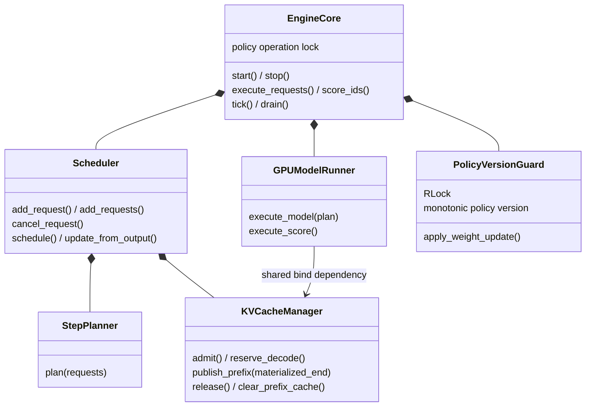

# Core Layer

`astrai/inference/core/` owns request lifecycle and logical KV accounting.
It runs in the same process as the model and trainer. The frontend receives
token-ID events; model execution consumes neutral data contracts.

## Driver and scheduler

`EngineCore` owns the execution loop, tokenized request execution and scoring
entry points, pending execution handles, policy version boundary, `Scheduler` and
`GPUModelRunner`. `Scheduler` owns request queues, logical KV state, planning
and result application. It never holds or invokes `EngineCore` or the model
runner. `StepPlanner` only builds execution entries and reports KV extension
failures; `EngineCore` submits plans and drains results.

This separates orchestration from scheduling policy: changing admission or
prefill windows should not change GPU submission and shutdown. `StepPlanner`
works with scheduler-owned requests and KV reservations; it is not a second
training or inference loop.

The scheduler owns one request registry, waiting/running queues and terminal
accounting. EngineCore's operation lock serializes mutations. Scoring requests
use the same registry without entering generation queues. Cancelled in-flight
requests remain registered until execution retires, protecting their IDs and KV.

The mutable `Request` belongs to the core. Planning captures an execution
snapshot; worker execution must not read a changing request or append to its
output. Result application validates execution/request identity and policy
version, then advances the corresponding live request. Reapplying a result
must not append the same token twice.

`Scheduler.add_request` preserves scalar tokenization and delegates its
prepared tokens to the batch construction path. Token budgets and request
construction have one implementation. Batch tokenization still runs once,
and all requests are validated before a single atomic enqueue, so a bad
request cannot leave a valid prefix registered.

`astrai.trainer.backend.run_batch` is the synchronous token-ID API used by
training rollout. It validates and formats the batch, then calls
`EngineCore.execute_requests` to use the same `Scheduler.schedule()` and
submit/drain path as serving.

## Execution and event ordering

A step has three distinct responsibilities:

1. **Plan:** choose request windows and reserve the required KV resources.
2. **Execute:** submit the immutable plan; preserve its association with all
   execution handles, including multiple backend groups.
3. **Apply:** materialize the result, match it by identity, update request
   state and emit accepted token/terminal events.

Controlled decode overlap can submit a later step before an earlier result
is applied. Therefore an optimistic scheduling cursor is not proof that all
its KV is complete, and it is not an output-token count. Cancellation and
EOS may cause an already-submitted token to be discarded. That execution
still has to retire before its pages, result slots or request slots are
reused.

A change in the running batch drains prior work through the same result
application and event path. Draining is not merely a synchronization call:
any accepted tokens produced by the drained executions must be delivered.
Stopping similarly drains or safely retires in-flight work before clearing
request/KV state. A timed-out join retains the live thread and its state;
a second loop must not be started over it.

## KV page allocation

`BlockPool` owns the KV tensors and the request page table. A contiguous pool
fills each slot's fixed page IDs at construction. For a paged pool,
`KVCacheManager` reserves and releases physical pages using the pool's allocator.
When pages hold multiple tokens, a radix index tracks reusable full prefixes.

The request page table publishes newly allocated page IDs and increments its
version. Each workspace gathers the rows for its current batch when the ordered
slots or the table version change. Across a page crossing, the destination
address stays stable for CUDA Graph replay.

The scheduler admits and releases requests by ID. The planner reserves positions
with `reserve_decode(request_ids, positions)`, which returns one success flag per
request. Under pressure, a failed reservation leaves that request's pages intact.
The runner passes the positions in its execution plan to `bind` and receives a
model cache view. RoPE and attention read the same past-length tensor for decode.

Prefix publication requires
`publish_prefix(..., materialized_end=exclusive_token_end)`. The boundary
must come from completed execution, not from prompt length, allocated page
count, or a cursor already advanced for a later in-flight step. Only complete
pages below that boundary can be published. The sampled token is not yet in
KV until a subsequent model execution consumes it.

Radix re-recording must preserve valid descendants, and removal of an
ancestor must not leave descendants advertised by the reverse index. Physical
allocator references and prefix-index reachability are separate invariants.

Both layouts preallocate a GPU arena. Paged allocation currently
reserves prompt pages at admission; chunking limits computation, not that
initial reservation. Global token budgets, progressive prompt allocation and
recompute preemption are not introduced by this ownership refactor.

### Cache binding boundary

Logical ownership is separate from the current object dependencies.
`GPUModelRunner` receives the scheduler's `KVCacheManager` and calls `bind()`
for prefill, decode and scoring. The manager checks the planned positions against each request's reservation
and publishes pending physical page IDs. The workspace gathers rows when the
ordered slots or the source page-table version changes. Decode passes the
bound past lengths to both attention and RoPE. A request can have reserved
space beyond the position used by the current step.

## Policy versioning

`PolicyVersionGuard` remains the train/serve protocol: an RLock protects
in-place weight mutation and monotonically increasing versions. Every weight
commit invalidates KV from older weights. Execution plans carry the actual
version; a stale result cannot be applied as a new-version token.

Generation, scoring, admission and weight mutation use the same operation
boundary. Weight mutation requires a stopped/drained engine with no queued
requests. Colocated rollout holds the snapshot boundary around eval-mode
entry, generation and restoration. Replica publishers enter the receiving
backend's mutation boundary **before** copying weights, rather than copying
first and validating the version afterward.

No process boundary or model copy is added for colocated rollout. Existing
Rollout token/logprob results and the policy-version API remain the
training-facing interface.
