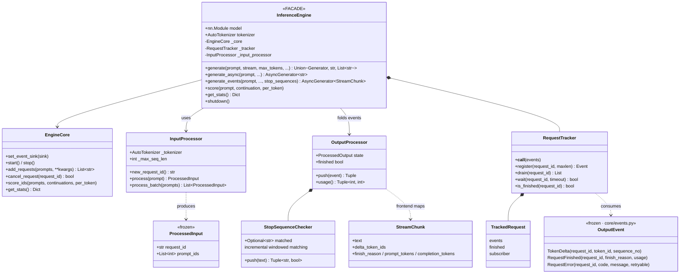

# Frontend Layer

`astrai/inference/frontend/` — everything that faces the user. The vLLM
analogue is the API process (`AsyncLLM` / `LLMEngine` +
`InputProcessor` / `OutputProcessor`); here it is an in-process layer so
colocated RL rollout keeps sharing the model object with the trainer.

Frontend code must not touch engine locks, hold `Request` objects beyond
submission, or read KV state.

## Classes



## Responsibilities

- **`InputProcessor`** tokenizes on the caller's thread (single or one
  batched `encode` call) and **mints the request id before submission**.
  Because the id exists before the scheduler knows about the request, an
  event can never precede its consumer — this is what allowed the old
  `_ResultSink` replay buffer to be deleted.
  Single and batch inputs then share one prepared-request submission path:
  register every consumer, submit the IDs and tokens through EngineCore,
  and release the registered requests if submission fails. Scalar tokenization
  remains available for tokenizers without a batch API; stream submission
  stays deferred until iteration starts.
- **`OutputProcessor`** folds events for one request: incremental
  detokenization (via `StreamDecoder`), stop-sequence matching with a
  sliding window over the ambiguous tail (never a full-body substring
  scan), and exact usage accounting from token deltas (never re-encoding
  text to count tokens). Degrades to token-id-as-string when the
  tokenizer lacks the Rust streaming handle, so a stream always
  terminates.
- **`EngineCore`** owns the request, scoring, status, event-sink and
  lifecycle operations used directly by the frontend. The engine accepts an
  existing core through `core=`; otherwise it constructs one in-process.
  Input truncation and event queue capacity use the core's resolved sequence
  limit, including when `core=` is supplied with different constructor options.
  The frontend attaches its event sink, starts the core and stops it on
  shutdown in either case. Locking and scheduler/KV ownership remain in the
  core. The deprecated frontend `scheduler` property has been removed.
- **`RequestTracker`** is also the core's event sink. One lock protects its
  event queues, completion events and async subscriptions. Terminal delivery
  sets the same completion event used to suppress duplicate/late output;
  there is no second sink object or terminal callback. Async notifications
  are posted after releasing the lock, and a closed consumer loop restores
  undelivered events to the pending queue.

`OutputProcessor` emits text deltas and retains token IDs for usage and delta
boundaries, but does not accumulate another full-text copy. Ordinary streaming
protocol responses forward the deltas directly. Only tool parsing retains a
streaming text body; non-streaming responses collect fragments and join once.
Terminal protocol events carry finish metadata without replaying output text.


## Blocking generate is completion-driven

Non-streaming `generate` runs **no helper thread**. It submits, parks the
caller on the per-request finished events, and when every request has
terminated folds all events at once on the caller's thread
(`_collect_blocking`). Per-step fold wake-ups were a measured host
overhead: each wake is a GIL handoff with the scheduler loop at exactly
the worst time (between commit and the next submit). Folding once, after
the batch is done, moves the same work off the decode loop entirely; the
event queues for blocking generate are sized to `max_seq_len + 1` so
accumulating until completion never drops tokens. Streaming entry points
keep incremental folding — their consumers want text as it is produced.

## Error containment

The completion-driven fold is fault-tolerant: a per-request fold failure
keeps that request's partial text instead of losing the whole batch, and
a `RequestError` terminal event is logged and reported through the same
partial-text path rather than hanging the caller. The scheduler's
`_emit_events` catches sink exceptions — consumer failures never reach
the engine loop.

Text-stop completion is separate from core completion. An early text stop,
consumer exception or closed iterator aborts the unfinished core request;
a naturally delivered core terminal does not trigger a redundant abort.
The tracker marks terminal state before notifying a consumer and ignores
subsequent duplicate/late events. Single-character stop strings retain no
ambiguous suffix, while a natural terminal flushes the unmatched suffix.
Prompt usage is initialized from the already-tokenized input so an early
text stop still reports the correct prompt length.

## Tokenizer and generation configuration

AstrAI reads HF tokenizer files: `tokenizer.json`, `tokenizer_config.json`,
optional `special_tokens_map.json`, and `chat_template.jinja`. Named tokens
use `bos_token`, `eos_token`, `pad_token`, and `additional_special_tokens`;
their IDs come from the vocabulary. Private `special_tokens` and
`stop_token_ids` fields are rejected and must be migrated before loading.
Saving exports the chat template as `chat_template.jinja`.

Generation defaults belong to the model's `generation_config.json`. If it
is absent, HF generation fields in `config.json` are used. The tokenizer's
EOS declaration does not implicitly set the generation stop conditions.
For AstrAI V1-2B, the actual vocabulary maps
`<｜end▁of▁sentence｜>` to 1 and `<｜im▁end｜>` to 130817:

```json
{"bos_token_id": 0, "pad_token_id": 2, "eos_token_id": [1, 130817]}
```

Per-call keyword arguments override the supplied `generation_config`, which
overrides the model defaults. Both a dictionary and a Transformers
`GenerationConfig` instance are accepted. Omitting `eos_token_id` inherits
the default; explicitly passing `None` or `[]` disables EOS stopping.
Length limits still apply.

```python
engine.generate(
    prompt,
    max_new_tokens=512,
    do_sample=True,
    temperature=0.8,
    eos_token_id=[1, 130817],
)
```

As in HF, `do_sample=False` selects greedy decoding; setting `temperature`
alone does not enable sampling. AstrAI supports greedy and multinomial
sampling, not every Transformers generation algorithm. Unsupported beam,
repetition-penalty and minimum-length settings raise errors. The
`max_tokens` argument remains the frontend alias for `max_new_tokens`;
passing both is an error.

Training checkpoints export tokenizer and generation files into staging
before manifest creation. This file convention does not convert AstrAI's
native model architecture, weight names or optimizer state into a
Transformers model.
