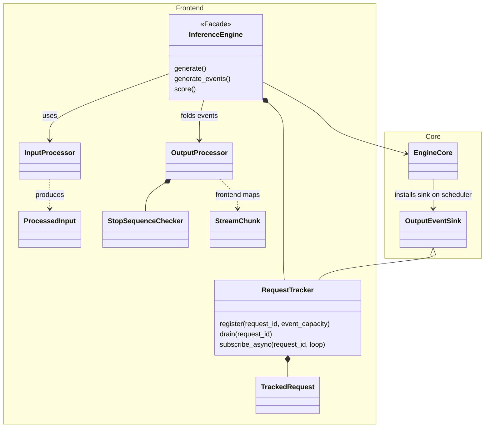

# Frontend Layer

The frontend is a **facade** for text generation and scoring. Network adapters
translate HTTP protocols around it; the frontend itself handles inputs and
output consumers. Keeping text work here lets tokenized training rollout use
the core directly, without duplicating the scheduling loop.

Frontend code must not touch engine locks, hold `Request` objects beyond
submission, or read KV state.

## Collaborators

The sink contract reverses event delivery without reversing source imports:
the core calls `OutputEventSink`, and the frontend supplies `RequestTracker`.
This is a single consumer outlet. Blocking and asynchronous consumption share
the same registration and terminal-state bookkeeping.

## Responsibilities

- **`InputProcessor`** tokenizes on the caller's thread (single or one
  batched `encode` call) and **mints the request id before submission**.
  Because the id exists before the scheduler knows about the request, an
  event cannot precede its consumer.
  Single and batch inputs then share one prepared-request submission path:
  register every consumer, submit the IDs and tokens through EngineCore,
  and release the registered requests if submission fails. Scalar tokenization
  remains available for tokenizers without a batch API; stream submission
  stays deferred until iteration starts.
- **`OutputProcessor`** folds events for one request: incremental
  detokenization (via `StreamDecoder`), stop-sequence matching with a
  sliding window over the ambiguous tail (never a full-body substring
  scan), and exact usage accounting from token deltas (never re-encoding
  text to count tokens). Degrades to token-id-as-string when the
  tokenizer lacks the Rust streaming handle, so a stream always
  terminates.
- **`EngineCore`** owns the request, scoring, status, event-sink and
  lifecycle operations used directly by the frontend. The engine accepts an
  existing core through `core=`; otherwise it constructs one in-process.
  Input truncation and event queue capacity use the core's resolved sequence
  limit, including when `core=` is supplied with different constructor options.
  The frontend attaches its event sink, starts the core and stops it on
  shutdown in either case. Locking and scheduler/KV ownership remain in the
  core.
- **`RequestTracker`** is also the core's event sink. One lock protects its
  event queues, completion events and async subscriptions. Terminal delivery
  sets the same completion event used to suppress duplicate/late output;
  there is no second sink object or terminal callback. Async notifications
  are posted after releasing the lock, and a closed consumer loop restores
  undelivered events to the pending queue.

`OutputProcessor` emits text deltas and retains token IDs for usage and delta
boundaries, but does not accumulate another full-text copy. Ordinary streaming
protocol responses forward the deltas directly. Only tool parsing retains a
streaming text body; non-streaming responses collect fragments and join once.
Terminal protocol events carry finish metadata without replaying output text.

## Blocking generate is completion-driven

Non-streaming `generate` runs **no helper thread**. It submits, parks the
caller on the per-request finished events, and when every request has
terminated collects output on the caller's thread (`_collect_blocking`).
The normal path decodes the collected token IDs once; tokenizers without the
bulk path, errors and decode failures use incremental event folding.
This avoids per-step caller wakeups competing with the engine thread.
The event queues are sized to `max_seq_len + 1` so
accumulating until completion never drops tokens. Streaming entry points
keep incremental folding — their consumers want text as it is produced.

## Error containment

The completion-driven fold is fault-tolerant: a per-request fold failure
keeps that request's partial text instead of losing the whole batch, and
a `RequestError` terminal event is logged and reported through the same
partial-text path rather than hanging the caller. The scheduler's
`_emit_events` catches sink exceptions — consumer failures never reach
the engine loop.

Text-stop completion is separate from core completion. An early text stop,
consumer exception or closed iterator aborts the unfinished core request;
a naturally delivered core terminal does not trigger a redundant abort.
The tracker marks terminal state before notifying a consumer and ignores
subsequent duplicate/late events. Single-character stop strings retain no
ambiguous suffix, while a natural terminal flushes the unmatched suffix.
Prompt usage is initialized from the already-tokenized input so an early
text stop still reports the correct prompt length.

The frontend submits the prepared token IDs and request IDs as one batch. Direct core callers may also submit text for encoding. The output processor uses the tokenizer's incremental decoder.
