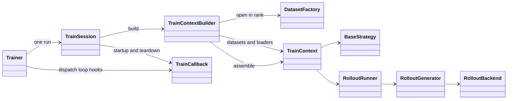

# Trainer internals

Trainer has four cooperating parts: a run loop, a constructed context,
an objective strategy, and optional rollout. Callbacks observe lifecycle
events and own persistence or presentation. This folder follows the same
subsystem-level layout as the [inference internals](../inference/README.md).

```text
astrai/trainer/
  trainer.py, session.py, train_context.py   loop, lifetime, construction
  components.py                            model, dataset, loader, optimizer, scheduler
  strategy/                                  objectives and loss contracts
  rollout/, backend.py                       generation and reward path
  callbacks/, optional_extras.py             hooks and checkpoint extras
  schedule.py                                 learning-rate policies
```

The dependency direction is Trainer -> TrainSession -> TrainContextBuilder ->
strategy and rollout. Rollout generation depends on a backend; objectives
consume scored rollout results. Callbacks receive TrainContext after an event
rather than owning the optimizer loop.

## Documents

| Document | Scope |
| --- | --- |
| [configuration.md](configuration.md) | Canonical optimizer settings and resolved rollout configuration |
| [lifecycle.md](lifecycle.md) | Trainer, session, context, configuration and scheduler |
| [strategy.md](strategy.md) | Strategy protocol, registration, capabilities and objectives |
| [rollout.md](rollout.md) | Backend, generation, scoring, worker protocol and weight transport |
| [async_round.md](async_round.md) | One-learner asynchronous GRPO execution and failure boundaries |
| [callbacks.md](callbacks.md) | Hook order, checkpoint state, metrics and optimization hooks |

## Ownership



TrainConfig carries one serializable ComponentSpec shape for model, dataset,
optimizer and scheduler. TrainContextBuilder resolves each spec after rank
launch; TrainContext keeps the constructed datasets and loaders.
Trainer owns optimizer commits and counters. TrainContextBuilder owns creation
and checkpoint restore; TrainSession owns startup and cleanup after construction.
A strategy owns its objective, not the run lifecycle. A rollout backend owns
where inference executes and how policy weights arrive.

The package exports Trainer, factories and protocols from astrai.trainer.
Built-in callbacks, strategies and rollout contracts have their own package
exports. StrategyFactory publishes capability declarations to TrainConfig
when strategies register, so configuration validation has no trainer imports.
Type-only callback imports use TYPE_CHECKING.

For configuration and usage, see the [training guide](../../guides/training.md)
and [distributed training guide](../../guides/distributed.md).

## FSDP module ownership

`FSDPExecutor` applies `fully_shard` to each distinct `DecoderBlock`, then
to the root model. The root owns remaining embeddings, final norms and
output heads; a tied embedding/head is a single root parameter. Reusing the
same block in a loop wraps it once. Parameters shared across distinct blocks
or between a block and the root are rejected before wrapping.

Configure `executor_kwargs={"reshard_after_forward": True,
"root_reshard_after_forward": False}` to reshard blocks after forward while
keeping the root parameters available through backward. These are the
defaults; each can be set explicitly for a capacity/communication experiment.
With `layerwise=False`, all parameters share one coarse root group, preserving
tied ownership without per-block groups. Generic backbones with a `layers`
ModuleList also retain layerwise support. The upstream
`keep_unsharded_during_accumulation` option remains available.
The policy follows the bottom-up grouping described in the
[PyTorch FSDP2 documentation](https://docs.pytorch.org/docs/main/distributed.fsdp.fully_shard.html).

CPU checks validate the call order, unique parameter ownership, dynamic
root class compatibility and reshard arguments. The two-GPU test compares
updates and canonical weight checkpoints for tied/untied heads. It requires
assigned test GPUs. Real all-gather traces, peak memory and official weights
are separate qualification results; CPU checks do not establish GPU support.
This change does not address full-weight loading peaks or reference-model
replication, and distributed FSDP online rollout remains gated.
