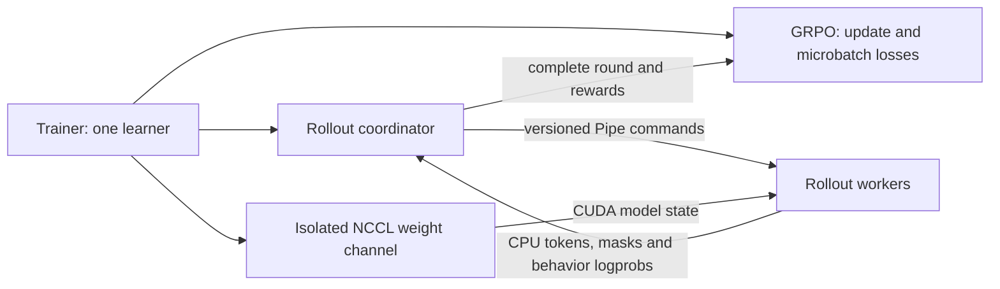

# Asynchronous multi-GPU GRPO

This page describes the opt-in local async_round mode implemented by
rollout/async_round.py, worker.py, protocol.py and nccl_transport.py.
The synchronous online path and colocated backend are described in
[rollout.md](rollout.md).

The current `async_round` mode has one CUDA learner and one spawned process
per configured rollout device. The learner owns the trainable actor, optimizer,
learning-rate scheduler, frozen KL reference and checkpoints. Each worker owns
its frozen actor, inference backend, CUDA Graph and KV cache. A worker's
inference engine remains in the same process as that worker's model; the
colocated backend still shares the learner model in its existing process.

### Ownership and version boundaries

- Trainer uses the same batch/update loop for synchronous and asynchronous
  strategies. It commits the optimizer, scheduler and checkpoint counters.
- GRPO weights complete prompt microbatches by their valid-token or nonempty
  response counts. One collected round produces one optimizer update.
- The coordinator partitions prompts, preserves response order, scores rewards
  and validates request ID, round ID and policy version before yielding a round.
  It owns at most one pending generation round; partial results never reach
  the learner.
- The Pipe carries control messages and CPU rollout results. KV cache and full
  logits stay on each worker. NCCL carries model state through a standalone
  process group; workers are not training or checkpoint ranks.

Round zero uses the initial actor. The training iterator performs these steps:

1. Collect the current raw round and validate its request, round and policy
   identities and allowed policy lag.
2. If another batch exists and stopping has not been requested, synchronize
   the latest weights and submit that batch as the single prefetched round.
3. Score rewards for the current raw round and yield its complete
   `RolloutResult`.
4. Let the learner commit the current update, then collect the prefetched round.

This ordering allows generation to overlap both reward scoring and the learner
update, with a maximum lag of one optimizer version. It does not make reward
scoring asynchronous. The public `collect_round()` method still blocks until
its requested round is collected and scored, and does not submit another round.
Every worker joins each weight broadcast, including workers with no prompts in
a short final round; an ACK is sent only after CUDA completion.

A failed or stale collection performs no learner update. An optimizer update
that advanced the policy version remains a committed step even if later
publication fails. Resume restores the completed sample cursor and version,
rebuilds worker replicas, and discards pending prefetched results. Submitting a
prefetch advances only the coordinator's request-seed cursor; the checkpoint's
sample cursor advances when the learner commits an update.

The iterator checks for a stop before starting and before fetching a following
batch. A current round already being collected can finish scoring and training;
an already submitted prefetch is discarded during shutdown. Within the training
iterator, reward failure, iteration failure or explicitly closing it aborts the
channel and terminates remaining workers, including an active prefetch. Session
shutdown also terminates workers and aborts the channel if a prefetched round
has not been collected: a worker sending a large result may be unable to read
STOP until the learner drains that result. When no round is pending, shutdown
sends STOP and enters NCCL shutdown on the learner before joining workers.

### Capacity and extension boundary

This mode is local, opt-in, dense online GRPO with one learner, one update per
round, and no validation backend. Add workers only while generation remains
slower than learner computation; extra replicas do not accelerate the learner.

Synchronous online training already accepts DDP with replicated inference
views. Extending this asynchronous coordinator to several learners is a
separate topology change. It must use the actual training reducer group for
global GRPO normalization, keep complete prompt groups within
update windows, and coordinate checkpoint cursors across learner ranks. FSDP
also needs a qualified actor-loading/reference-memory path and a full-policy
publication protocol for sharded state. The rollout-only NCCL group must stay
separate from those training groups. Merely removing the single-learner
configuration gate would not supply these guarantees.

### Parameter resolution and reproducible sampling

`TrainConfig` rejects unknown fields. The common training parameters
`rl_update_epochs`, `rl_minibatch_prompts`, `gradient_chunked_logprobs` and
`moe_aux_loss_coef` belong on `TrainConfig`; putting them in `strategy_kwargs`
is an error. The strategy owns its resolved `group_size` (GRPO defaults to 4,
requires at least 2 online), and rollout uses that same value.

Before loading models, the builder checks the actual distributed world size:
`async_round` requires one learner even under torchrun. Rollout setup resolves
devices, sampling, capacities, timeouts and the committed sample cursor into
an immutable `ResolvedAsyncRolloutConfig` in `rollout/setup.py`. All CUDA indexes
are logical indexes
after `CUDA_VISIBLE_DEVICES`; worker devices must be distinct and exclude the
learner. Startup logs include device assignments, GPU UUIDs, effective sampling,
seed/cursor and the three independent deadlines:

- `rollout_startup_timeout_s`: startup, default 300 seconds.
- `rollout_worker_timeout_s`: generation, default 600 seconds.
- `rollout_weight_timeout_s`: NCCL broadcast and ACK, default 600 seconds.

The generation deadline starts when the round is submitted. Reward scoring and
learner computation can delay collection of a prefetched result beyond that
deadline. In that case, collection first checks for ready worker replies
without waiting: ready results are still accepted and validated, while a worker
with no ready reply times out. Startup and weight ACK collection retain their
own deadlines and do not accept replies after those deadlines.

Each generated response receives a seed derived from `random_seed`, its global
prompt cursor and its response index. Request execution derives a stateless
per-token stream from that seed and token position. Sampling therefore does not
consume the worker's global RNG and is independent of worker assignment,
request order and batch compaction. A stale retry reuses its seeds; resume derives
new requests from the committed cursor, discarding prefetched results as before.
Identical weights and logits are required for token equality. Resume can load a
newer policy than an abandoned prefetched round, and different numerical kernels
can produce different logits; request seed equality alone cannot remove those
differences.
