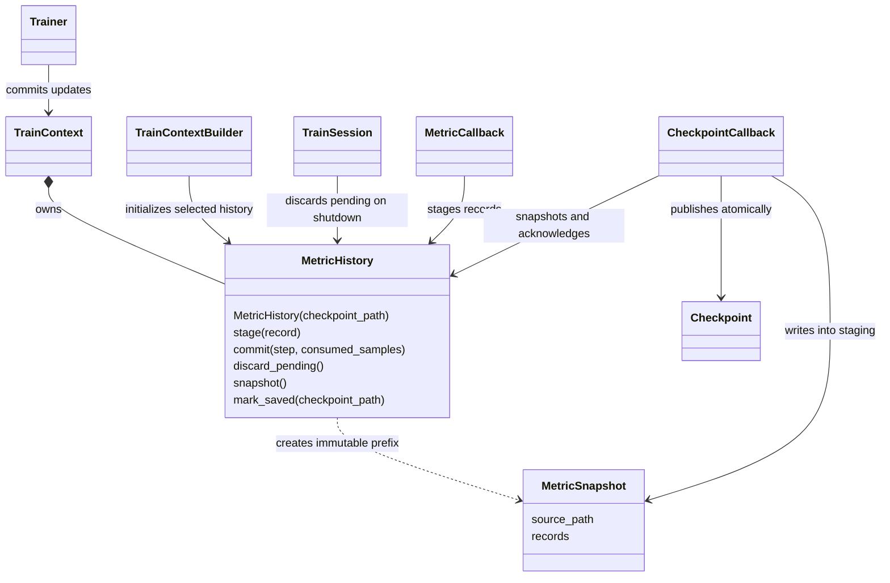

# Callbacks and checkpoint state

Callbacks observe a TrainContext at lifecycle boundaries. Trainer dispatches
epoch, batch and optimizer hooks. TrainSession dispatches startup and teardown
hooks and makes a best-effort cleanup pass when startup or training fails.

## Responsibilities

| Module | Responsibility |
| --- | --- |
| callbacks/base.py | TrainCallback lifecycle hooks |
| callbacks/checkpoint.py | Periodic, final and emergency checkpoint writing |
| callbacks/metrics.py | Compute training metrics and validation; stage records |
| context/metric.py | Pending records, committed history and save snapshots |
| callbacks/metric_util.py | Metric accessors, gradient norm and GradSNRTracker |
| callbacks/optimization.py | Gradient clipping and activation checkpointing |
| callbacks/progress.py | Epoch progress display |
| optional_extras.py | Global RNG/FP8 and strategy-owned checkpoint extras |

MetricCallback and CheckpointCallback have no references to each other. Both
operate on the run-owned history in TrainContext. MetricSnapshot is a frozen
value containing the prior history path and serialized records, not another
callback or service; file writing belongs to CheckpointCallback. The current
metric values remain in context.metrics.

## Update boundary

MetricCallback stages pre-update measurements in before_optimizer_step. Trainer
commits them with the final optimizer step and sample cursor only after a
successful update, before dispatching any after_optimizer_step callbacks.
Reordering the metric and checkpoint callbacks cannot change which records a
checkpoint captures. Gradient clipping still acts before the optimizer step.

A failed offline update discards pending records and rolls back the counters;
the existing checkpoint-safe guard prevents publication of partially updated
weights. An online policy version advance marks a committed update even if
subsequent publication raises: its metric records follow the committed counters.
Without a version advance, pending records are discarded. TrainSession also
discards pending records before shutdown callbacks attempt an emergency save.

## Persistence and resume

CheckpointCallback captures a history snapshot and writes metric.jsonl inside
the checkpoint staging directory, together with model, optimizer, scheduler,
metadata, registered extras and available tokenizer files. Checkpoint.save
creates the manifest and atomically publishes the directory. Only then does
MetricHistory update its source path and clear the saved records from memory.
Saving is synchronous: training cannot commit another update between taking
the snapshot and confirming publication. Failed writes keep the records for
retry. An existing checkpoint cannot silently discard unsaved records.

Every checkpoint contains cumulative committed history: the previous saved
JSONL is streamed from disk, followed by the snapshot's records. Historical
records are not all loaded into memory. TrainContextBuilder restores history
from the selected resume checkpoint before startup callbacks run; loading
weights for a new run does not inherit the old run's metrics. Checkpoints
without metric.jsonl start with empty history. The checkpoint format, metric
record schema, validation cadence and GNS calculation remain unchanged.

optional_extras.py records enabled global RNG/FP8 state and strategy-owned
state such as a critic or frozen reference. The builder restores each component
after its owner exists. Unknown optional keys are ignored on restore.
