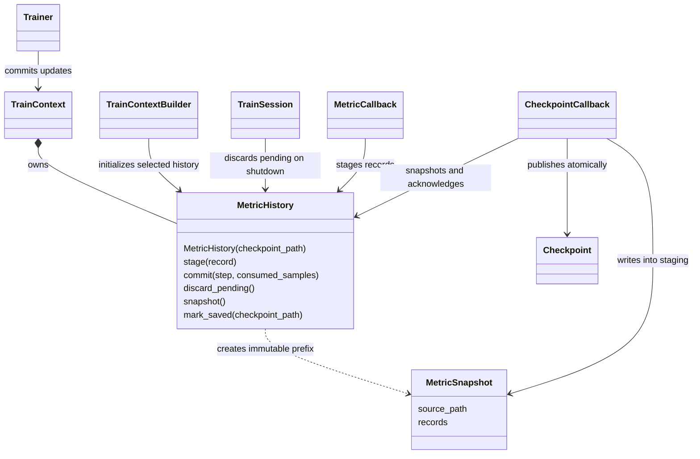

# Callbacks and checkpoint state

Callbacks observe a TrainContext at lifecycle boundaries. Trainer dispatches
epoch, batch and optimizer hooks. TrainSession dispatches startup and teardown
hooks and makes a best-effort cleanup pass when startup or training fails.

## Responsibilities

| Module | Responsibility |
| --- | --- |
| callbacks/base.py | TrainCallback lifecycle hooks |
| callbacks/checkpoint.py | Periodic, final and emergency checkpoint writing |
| callbacks/metrics.py | Compute training metrics and validation; stage records |
| context/metric.py | Pending records, committed history and save snapshots |
| callbacks/metric_util.py | Metric accessors, gradient norm and GradSNRTracker |
| callbacks/optimization.py | Gradient clipping and activation checkpointing |
| callbacks/progress.py | Epoch progress display |
| optional_extras.py | Optimizer, scheduler, FP8 and strategy-owned checkpoint extras |

MetricCallback and CheckpointCallback have no references to each other. Both
operate on the run-owned history in TrainContext. MetricSnapshot is a frozen
value containing the prior history path and serialized records, not another
callback or service; file writing belongs to CheckpointCallback. The current
metric values remain in context.metrics.

## Update boundary

MetricCallback stages pre-update measurements in before_optimizer_step. Trainer
commits them with the final optimizer step and sample cursor only after a
successful update, before dispatching any after_optimizer_step callbacks.
Reordering the metric and checkpoint callbacks cannot change which records a
checkpoint captures. The default GradientClippingCallback precedes MetricCallback
and ProgressBarCallback: its returned pre-clipping norm belongs to the current
update, including the first one. Reuse this value rather than scanning the
gradients again. Custom callback orders must preserve that dependency.

The opt-in temporal `grad_snr` samples at most 65,536 fixed gradient coordinates
from the reduced and clipped update, independent of model size. MetricCallback
stages a proposed EMA and value; Trainer commits that state together with metric
history only after a successful update. Failure or shutdown discards the proposal.
Unsampled, non-finite, first and unresolved observations omit the metric. GradSNR
is a sampled temporal diagnostic, not a fixed-weight Gradient Noise Scale or an
optimal-batch-size estimate.

The global-window path covers offline and synchronous online training. If an
update fails, it discards pending records and restores that update's counters;
this does not restore mutated weights or undo an already advanced policy
version. `checkpoint_safe` remains false, and the run must stop.

The asynchronous-round path retains step/sample counters when the actor version
has advanced, even if later work fails. It commits metric records and marks the
checkpoint safe only after algorithm post-update work, gradient clearing and
scheduler advancement succeed. A failure in that local work discards pending
records and leaves the checkpoint unsafe. Without a version advance, the round
does not advance counters. TrainSession discards any remaining pending records
before shutdown callbacks attempt an emergency save.

## Experiment metrics

`on_rollout(context)` reads `context.kwargs["batch"]`, a CPU snapshot of a
freshly scored training rollout. The snapshot contains the sampled policy version, prompt
texts, rewards, response lengths and finish reasons in prompt-group order.
Synchronous padding rows and cached rollouts are excluded. Each callback can
return a mapping from metric names to `(numerator, denominator)` pairs. All
contributions for a name use the same units. Trainer sums them across the
rollout window and data-parallel ranks, then divides once. A metric with a
zero global denominator is omitted.

The rollout record is committed with the first successful optimizer update
for that window. Replaying the same rollouts for more learner updates produces
no additional records. A resume inherits records from the selected checkpoint.

`on_log(context)` reads `context.kwargs["record"]`, a copy of a newly committed
record. It runs on global rank zero after the optimizer hooks. The record
includes its step and sample cursor. Use this hook for output and avoid
distributed collectives inside it. Historical records from a resume are
available in the checkpoint's `metric.jsonl`.

The event's entry in `context.kwargs` is scoped to the callback invocation.
Trainer restores the prior entry when the callback returns or raises.

## Persistence and resume

CheckpointCallback captures a history snapshot and writes metric.jsonl inside
the checkpoint staging directory, together with model, optimizer, scheduler,
metadata, registered extras and available tokenizer files. Checkpoint.save
creates the manifest and atomically publishes the directory. Only then does
MetricHistory update its source path and clear the saved records from memory.
Saving is synchronous: training cannot commit another update between taking
the snapshot and confirming publication. Failed writes keep the records for
retry. An existing checkpoint cannot silently discard unsaved records.

Every checkpoint contains cumulative committed history: the previous saved
JSONL is streamed from disk, followed by the snapshot's records. Historical
records are not all loaded into memory. TrainContextBuilder restores history
from the selected resume checkpoint before startup callbacks run; loading
weights for a new run does not inherit the old run's metrics. Checkpoints
without metric.jsonl start with empty history. The optional `grad_snr` extra saves only committed EMA moments, sampled coordinates, parameter layout,
observation count, optimizer step and sampling interval. Full resume validates
these against the current run; warm starts create fresh estimator state.

optional_extras.py records optimizer, scheduler, enabled FP8 state and
strategy-owned state such as a critic or frozen reference. Global RNG state is
not currently persisted, so resume is not guaranteed to reproduce stochastic
training bit for bit. The builder restores each component
after its owner exists. Unknown optional keys are ignored on restore.
