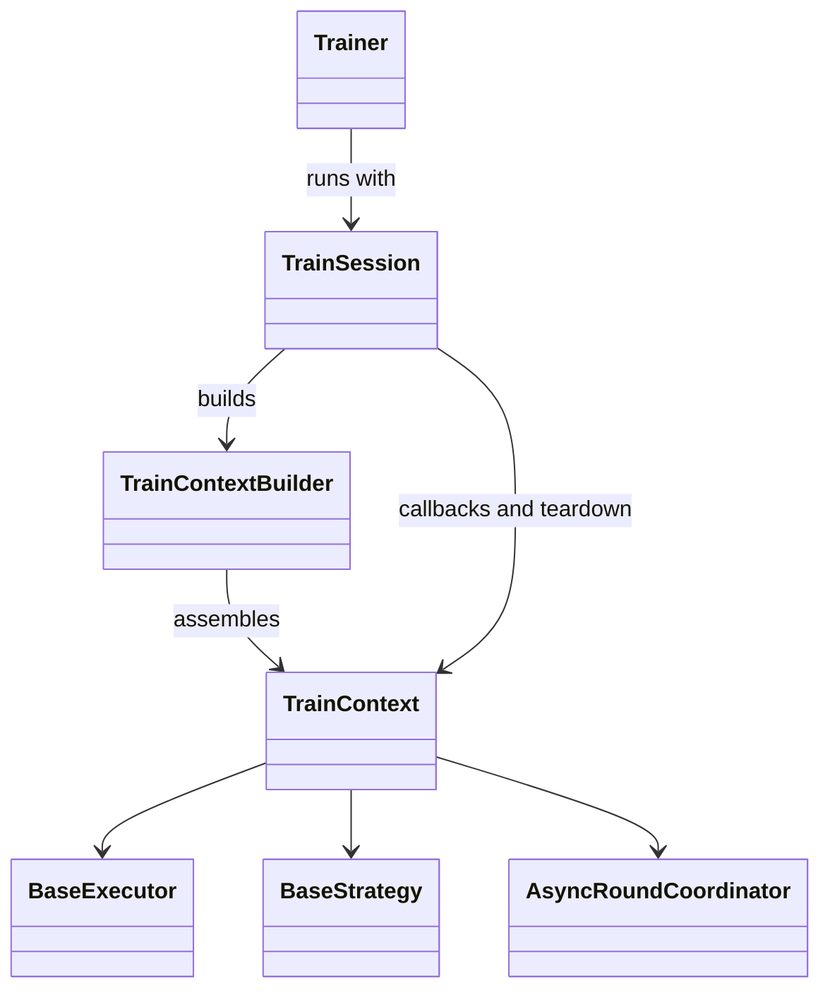

# Run lifecycle and construction

The run loop is in trainer.py, startup and cleanup in session.py, and object
assembly in context/builder.py, and component construction in components.py.
TrainConfig remains the public configuration. The optimization/scheduler package
supplies registered learning-rate policies.

## Source modules

| Module | Responsibility |
| --- | --- |
| trainer.py | Epoch/batch loop, gradient accumulation, optimizer and scheduler commits, loop callbacks |
| session.py | Signal handlers, startup callbacks, error and end callbacks, rollout closure, final barrier |
| context/builder.py, context/state.py | Context state and rank-local assembly order, strategy and rollout wiring, checkpoint restore |
| components.py | Model, dataset, DataLoader, optimizer, scheduler and reference-model construction |
| ../../optimization/scheduler/ | Cosine, SGDR and WSD learning-rate implementations and scheduler registry |

## Loop and lifetime

TrainSession is an internal context manager for one run of Trainer.train().
It keeps the epoch/batch algorithm in Trainer and gives startup and teardown
one owner. TrainContextBuilder has a separate construction boundary because
TrainSession cannot clean up a context that build() has not returned.

The builder resolves topology and persisted state, creates the executor and
context, then prepares the model, optimizer, datasets, strategy and rollout.
After a context exists, a failed build closes its assigned async rollout and
re-raises the original error. AsyncRoundCoordinator also closes workers and
its weight channel if its own constructor fails before assignment.

On a successful build, the session registers signal handlers and calls
`on_train_begin`. Trainer runs epochs and optimizer windows. A requested stop
is observed at a safe boundary; the session handles publication and cleanup.

The shutdown order is the same for normal completion, a stop request and errors:

1. Run registered cleanup hooks, including stopping DataLoader workers.
2. Discard pending metric records and dispatch `on_shutdown`.
3. Close asynchronous rollout, then dispatch `on_train_end`.
4. On a successful run, attempt the distributed barrier.
5. Restore the prior signal handlers.

Every cleanup action is attempted even after another fails. A cleanup exception
does not replace the original startup or training exception. Without an earlier
exception, the first cleanup error is raised after the remaining actions.

A build failure before the context returns is handled by the builder; session
callbacks have not started. A failure during signal registration or
`on_train_begin` uses the session cleanup plan. Checkpoint callbacks still check
`checkpoint_safe`: an exception does not authorize publishing partially updated
weights. See [checkpoint semantics](../../guides/training.md#checkpoint).

## Context and checkpoint settings

TrainContext is the mutable state shared by Trainer, strategies, callbacks,
and rollout. It records the model, optimizer, scheduler, executor, data
loaders, step counters and stop request. TrainContextBuilder constructs those
objects in dependency order, restores checkpoint state, and closes an
assigned asynchronous rollout if construction fails.

create_ref_model() creates the frozen reference policy for strategies that
declare that capability. The builder uses StrategyCapabilities for auxiliary
models and calls rollout/setup.py for online execution. A completed context
is handed to TrainSession for lifecycle management.

TrainConfig carries the same serializable ComponentSpec shape for model,
dataset, optimizer and scheduler. Each rank enters TrainContextBuilder, which
resolves the specs and opens the datasets through components.py, then constructs
DataLoaders. TrainContext owns the resulting datasets and loaders. The built-in
packed type uses DatasetFactory; a Python dataset uses its module:attribute path
as the spec type.

Model, optimizer and scheduler are created in dependency order after rank
launch. A scheduler parameter may reference $total_steps, $warmup_steps,
$decay_steps or $dataset_len. TrainConfig.to_dict() records JSON-compatible
settings and does not copy runtime objects.

Checkpoint restore still belongs to TrainContextBuilder. The builder loads
model state before strategy and rollout setup, restores optimizer/scheduler
state, and then restores optional reference or critic extras. Callbacks write
the settings snapshot through context.config.to_dict(); they do not serialize
runtime dependencies.

Trainer advances the scheduler only on committed optimizer updates.
