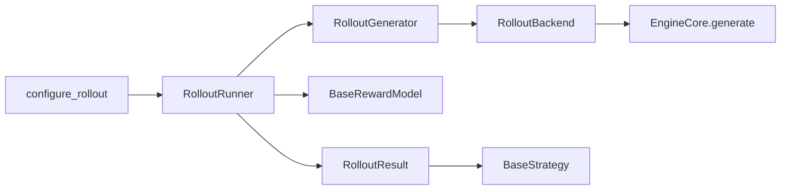

# Rollout path

Rollout turns prompts into scored, versioned results for online objectives.
The backend chooses execution placement; generator formats and decodes;
runner scores and validates; the strategy consumes the result.

## Source modules

| Module | Responsibility |
| --- | --- |
| backend.py | Colocated or frozen replica execution and policy-version updates |
| rollout/types.py | RawRollout, RolloutResult, SamplingParams and reward-model contract |
| rollout/generator.py | Prompt preparation, grouped generation and decoding |
| rollout/runner.py | Reward scoring, policy-version checks, replay cache and evaluation |
| rollout/setup.py | Backend assembly and resolved async device/sampling settings |
| rollout/batching.py | Prompt slicing and ordered worker-result merge |
| rollout/async_round.py | Round scheduling, reply validation and prefetch |
| rollout/worker.py | Spawned frozen inference replica and request execution |
| rollout/protocol.py | Versioned Pipe messages and result envelopes |
| rollout/nccl_transport.py | Separate learner-to-worker weight broadcasts and ACKs |

## Placement and version boundary

ColocatedBackend shares the learner model; ReplicaBackend owns a frozen copy.
Both implement RolloutBackend so RolloutGenerator does not know where inference
runs. The policy snapshot boundary prevents generation from observing a
partially published update. RolloutRunner rejects stale versions before a
scored result reaches the learner.

Both backends pass tokenized prompts to `EngineCore.generate()` and return
`List[GenerationResult]` in input order. Each result contains token IDs,
logprobs, a finish reason and an optional error reason. RolloutGenerator
explicitly requests `return_logprobs=True` to populate `logprobs_old`; callers
that leave it disabled receive the same result structure with empty logprob
lists.

AsyncRoundCoordinator distributes prompts, merges results in input order and
checks request, round and policy identities. Worker processes keep their own
KV cache and CUDA Graph. Its training iterator collects and validates the
current raw round, submits at most one following round, then scores the current
rewards and yields the result to the learner. This allows generation to overlap
reward scoring and learning. Calling `collect_round()` directly still collects
and scores only the requested round.

The Pipe carries control and CPU results; a separate NCCL group transports CUDA
model weights. A stop suppresses further prefetch when observed, and a reward
or iteration failure closes any active prefetch. Session shutdown terminates
workers and aborts the channel when a round remains uncollected; otherwise it
uses STOP and coordinated NCCL shutdown. Delayed collection accepts already
ready generation replies even if reward scoring or learning outlasted the
generation deadline; startup and weight ACK deadlines remain separate. For
lifecycle, timeout and resume details, see [async_round.md](async_round.md).

## Decode overlap

`TrainConfig.rollout_enable_overlap` defaults to `True` and applies to colocated
generation, training and validation replicas, and each `async_round` worker.
Set it to `False` to submit and resolve each decode step sequentially.

The blocking `EngineCore.generate()` API uses the same execution driver as
the online inference loop. For an eligible steady decode batch, it submits
GPU step N+1 before resolving step N on the CPU. The previous sampled tokens
feed the next step directly on the device. Prefill, batch membership changes,
frequency penalties, and generation limits retain the drain-before-submit path.

All submitted work drains before generation returns. The policy snapshot and
weight-update lock cover the full call, so a rollout observes one policy
version throughout. This option controls CPU/GPU decode pipelining inside a
backend; learner/rollout concurrency remains controlled by `rollout_mode`.
