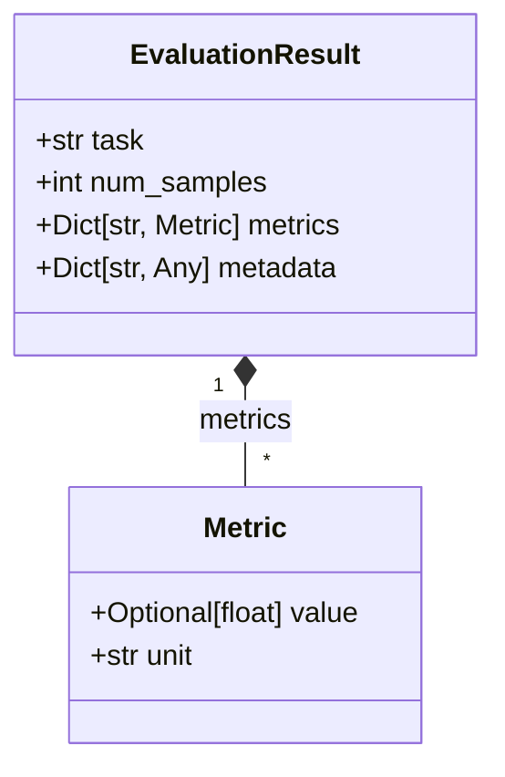
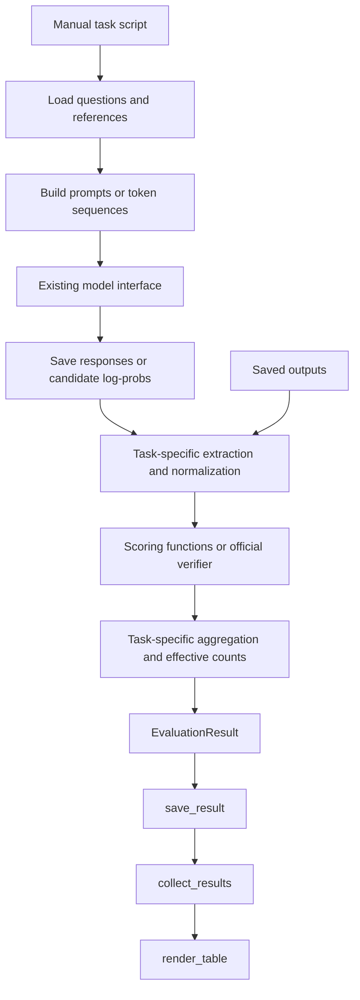

# Evaluation

Run each task manually from the repository root. Scripts own data loading,
prompt construction, answer extraction and task-specific denominators.
`astrai.evaluation` provides reusable scoring, result storage and model/execution
helpers. There is no task registry, job scheduler or checkpoint watcher.

## Responsibilities

```text
astrai/evaluation/
├── __init__.py   # Explicit public exports
├── scoring.py   # Exact match, means, pass@k, perplexity and code-score aggregation
├── results.py   # Result types, JSON I/O and Markdown comparison tables
└── utils.py     # Model loading, causal log-probs, sampling and code execution
```

The helpers live inside the package so scripts can be run directly with
`python scripts/eval/evaluate_*.py`. They do not own a training process or
choose GPUs. Scripts pass prepared values to scoring functions and construct
results with explicit metric units. Adding a task requires no registration.

Only results need data classes; functions are not represented as classes:





| Function | Contract |
|---|---|
| `exact_match(prediction, reference)` | Compare already-normalized values; no task regex or case conversion |
| `mean(values)` | Mean of a nonempty finite sequence |
| `pass_at_k(n, correct, k)` | Unbiased estimator; requires `0 <= correct <= n` and `1 <= k <= n` |
| `perplexity(nll_sum, token_count)` | `exp(total NLL / valid token count)`; positive token count required |
| `save_result(path, result)` | Validate and atomically replace a new-format summary |
| `load_result(path)` | Read only the explicit result schema |
| `collect_results(paths, benchmarks=None, tags=None)` | Collect summaries by their stored task; filenames supply run tags |
| `render_table(collected)` | Format units; missing values become `—` |

`loglikelihood_batched(model, requests, device, max_model_len)` takes token-ID
pairs `(context, continuation)`. Tokenization belongs to the caller, so there
is no tokenizer argument. `causal_sequence_logits` constructs causal masks,
padding masks and optional packed-document boundaries. The model backend and
FP32 log-softmax calculation are unchanged.

## Results and reproducibility

Summary files contain no raw generations:

```json
{
  "task": "gsm8k",
  "num_samples": 1319,
  "metrics": {
    "strict_match": {"value": 0.25, "unit": "ratio"},
    "flexible_extract": {"value": 0.25, "unit": "ratio"}
  },
  "metadata": {"prompt_format": "raw", "n_shot": 5}
}
```

The numbers above illustrate the schema, not a measured model score.
`num_samples` counts included questions/documents (weight analysis explicitly
uses tensors). Units are `ratio`, `count` and `number`. Unavailable metrics use
`null`, never NaN. Metadata records configuration and effective counts; it is
task-specific rather than a common configuration object.

Responses, candidate scores and verification details use separate
`.responses.jsonl`, `_details.jsonl`, `.details.json`, `_details.json`,
`_completions.json` or `_tested.json` files. Summary filenames and existing
single-task arguments are retained. Use a fresh output directory for new runs:
legacy summaries are neither converted nor overwritten. The collector reports
the filename of an unsupported JSON candidate, including when task filters are
specified. Detail sidecars are excluded.

For an optional comparison table, use the functions directly:

```python
from astrai.evaluation import collect_results, render_table

print(render_table(collect_results("results/new-run")))
```

Use names such as `mmlu_mid.json` and `gsm8k_mid.json` to align the `mid` tag.
There is no separate collection CLI.

## Task commands

Install the project's evaluation dependencies and select a GPU explicitly
when needed, for example `CUDA_VISIBLE_DEVICES=0`. `--param_path` accepts a
local AstrAI checkpoint directory. All commands below run from the repository
root; output paths are examples.

| Task | Entry point | Aggregation |
|---|---|---|
| HumanEval | `evaluate_humaneval.py` | Mean pass@k over problems with at least k samples |
| MBPP | `evaluate_mbpp.py` | Same estimator, retaining existing deduplication |
| MMLU | `evaluate_mmlu.py` | Question-weighted accuracy across subjects |
| HellaSwag | `evaluate_hellaswag.py` | Raw and character-normalized candidate log-prob ranking |
| GSM8K | `evaluate_gsm8k.py` | Strict and flexible numeric answer match |
| IFEval | `evaluate_ifeval.py` | Official strict/loose prompt/instruction accuracy |
| PPL | `evaluate_ppl.py` | Token-weighted NLL and perplexity |
| ROUGE | `evaluate_rouge.py` | Existing per-pair precision/recall/F1 means |
| IFD | `evaluate_ifd.py` | Existing valid-record statistics |
| Weights | `analyze_weights.py` | Tensor counts and component statistics |

```bash
python scripts/eval/evaluate_gsm8k.py --param_path ./params \
  --data_dir ./gsm8k --output results/new-run/gsm8k_mid.json
python scripts/eval/evaluate_mmlu.py --param_path ./params \
  --output results/new-run/mmlu_mid.json
python scripts/eval/evaluate_hellaswag.py --param_path ./params \
  --output results/new-run/hellaswag_mid.json
python scripts/eval/evaluate_humaneval.py --param_path ./params \
  --output results/new-run/humaneval_mid.json
python scripts/eval/evaluate_mbpp.py --param_path ./params \
  --output results/new-run/mbpp_mid.json
python scripts/eval/evaluate_ifeval.py --param_path ./params \
  --output results/new-run/ifeval_mid.json
```

GSM8K defaults to five seeded raw demonstrations and greedy generation.
`--prompt_format chat` is an explicit alternative. This is not an exact
lm-evaluation-harness protocol reproduction. MMLU defaults to raw five-shot
prompts; HellaSwag uses zero-shot continuation ranking. Do not compare scores
across differing prompt, context, normalization or sampling settings as if
they were the same evaluation.

HumanEval keeps every generated sample; MBPP keeps its existing deduplication
policy. Per-problem pass@k is rounded to four decimals before eligible-problem
averaging, as before. A task with fewer than k samples contributes no value to
that k's denominator; the summary records effective counts. Insufficient
samples produce `null`, not zero.

Code execution uses a Linux fork worker with a temporary directory, wall-clock
and CPU limits, 16 MiB per-file limit and 512 MiB additional virtual-address
space above the inherited baseline. This is not a private-RSS limit or a
security sandbox. The parent cleans up the process group, and early exits do
not count as passing. Windows can run non-execution tasks; this execution path
requires Linux/WSL.

IFEval requires the official `instruction_following_eval` package and its
dependencies. Use `--verifier_path` for its parent directory when it is not on
the import path. The verifier supplies constraint outcomes; strict/loose
prompt and instruction denominators remain separate.

```bash
python scripts/eval/evaluate_ppl.py --param_path ./params \
  --input_path ./data.jsonl --output_dir results/new-ppl
python scripts/eval/evaluate_ifd.py --param_path ./params \
  --input_path ./sft.jsonl --output_dir results/new-ifd
python scripts/eval/evaluate_rouge.py --data_path ./pairs.jsonl \
  --output results/new-run/rouge_mid.json
python scripts/eval/analyze_weights.py --ckpt_dir ./params \
  --output results/new-run/weights_mid.json
```

ROUGE input rows contain `reference` and `candidate`. PPL defaults to the
`text` field; use `--token_level` to retain per-token details. PPL uses Python
floating-point exponentiation of the same token-weighted NLL; older summaries
rounded the exponentiation through a float32 tensor. This can change trailing
digits without changing the evaluated tokens or model log-probabilities.

## Rescoring saved outputs

GSM8K, MMLU, HellaSwag and IFEval accept `--score_only PATH`. This skips model
loading. MMLU reads its `_details.jsonl`; HellaSwag reads `.details.json`;
GSM8K and IFEval read response JSONL. IFEval also needs the selected dataset and
official verifier. GSM8K and IFEval retain their required `--param_path` CLI
argument, but do not open that model in score-only mode.

```bash
python scripts/eval/evaluate_gsm8k.py --param_path ./params \
  --score_only results/new-run/gsm8k_mid.responses.jsonl \
  --output results/replayed/gsm8k_mid.json
python scripts/eval/evaluate_humaneval.py \
  --test_only results/new-run/humaneval_mid_completions.json \
  --output results/replayed/humaneval_mid.json
```

HumanEval and MBPP retain `--test_only` and `--generate_only`. ROUGE already
scores saved text. Historical raw files can be explicitly rescored into a
new path when they contain the fields the current script requires; no
automatic old-summary inference is performed. Existing external waiting
processes and fixed-version training directories are not migrated.
